<div align="center">

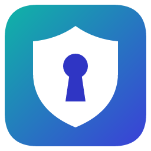

# KeepForge

### Your passwords, in one encrypted file that only you can open.

A secure, offline password manager for Windows, written in **Rust**.
No account, no cloud, no telemetry: the vault is a single file you own, encrypted with **XChaCha20-Poly1305** under a key stretched with **Argon2id**.

<p>
  
  
  
  
</p>

<p>
  
  
  
  
  
  
  
</p>

[**Features**](#-features) ·
[**Screenshots**](#%EF%B8%8F-screenshots) ·
[**Download**](#-download) ·
[**Security**](#%EF%B8%8F-security) ·
[**Online checks**](#-optional-online-checks) ·
[**Build**](#%EF%B8%8F-build-from-source) ·
[**Changelog**](CHANGELOG.md) ·
[**Developer**](#-developer)

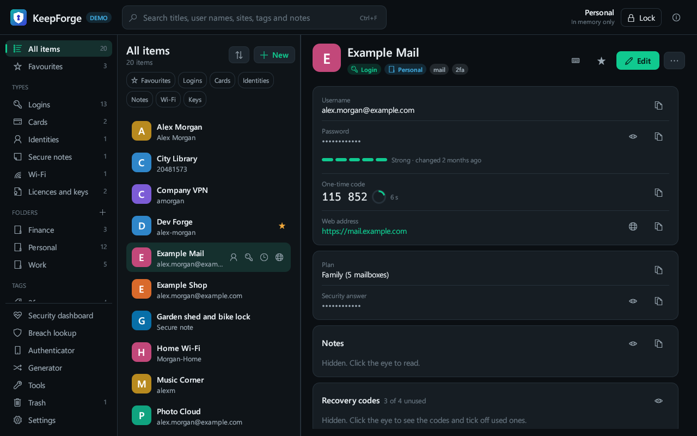

</div>

---

> [!IMPORTANT]
> **KeepForge has not been independently audited.** It is built from well-known, reviewed building blocks (the RustCrypto crates), but the way they are put together has been checked only by its developer and its own tests. Read [`docs/SECURITY.md`](docs/SECURITY.md), keep backups, and decide for yourself how much to trust it.

## ✨ Features

<table>
<tr>
<td width="50%" valign="top">

### 🔐 A vault that stays yours
- One encrypted `.kfv` file; keep it anywhere, including a synced folder
- Master password, plus an optional **key file**
- Logins, cards, identities, secure notes, Wi-Fi and licence keys
- Folders, tags, favourites, trash (it can empty itself), attachments by button or drag and drop
- Password **history** for every item, with restore
- Several vaults, rolling backups, merge when two PCs changed the file

</td>
<td width="50%" valign="top">

### ⚡ Easy every day
- Instant search (`Ctrl+F`) with type, folder and tag filters; sort by title, recently changed or recently added
- Arrow keys walk the list, also from the search box
- **Kurdish, Arabic, Persian and Hebrew** titles, notes and tags are drawn joined up and in reading order
- One click to copy a user name, password or one-time code
- **Auto-type** into the window you were using, by button or global hotkey
- Built-in **authenticator** (TOTP) with a countdown ring
- Auto-lock when idle and when Windows locks or sleeps
- Dark and light themes, tray icon, portable mode

</td>
</tr>
<tr>
<td valign="top">

### 🎲 Generator
- Random passwords with full control over length and character sets
- **Passphrases** from the EFF large wordlist
- User names, PINs and tokens
- Entropy and a realistic strength estimate (zxcvbn) as you type
- Available on its own page and inside the edit form
- Remembers the passwords you copied until the vault locks

</td>
<td valign="top">

### 🩺 Security dashboard
- Weak, reused and old passwords at a glance
- Incomplete logins, unencrypted `http://` addresses and items about to expire
- **Leaked password check** against Pwned Passwords (k-anonymity: only 5 characters of a hash leave your PC)
- **Email breach lookup**: which known breaches include your address
- Recovery-code tracking and a printable emergency sheet

</td>
</tr>
<tr>
<td valign="top">

### 🧰 Tools
- Password strength tester
- **Encrypt text or a file** with a password (`.kfx`)
- File checksums (SHA-256, SHA-512, SHA-1, BLAKE2b)
- QR codes for Wi-Fi and one-time-code setup
- Secure shred for files you no longer want on disk
- Torrent exposure check for your own IP address

</td>
<td valign="top">

### 🔄 Moving in and out
- Import CSV exports from common browsers and password managers (logins, notes, cards and identities), with column mapping for anything else
- Import one common JSON export shape
- Export an encrypted copy
- Plain CSV or JSON export behind a clear warning
- The file format is documented byte for byte in [`docs/FORMAT.md`](docs/FORMAT.md)

</td>
</tr>
</table>

## 🖼️ Screenshots

<table>
<tr>
<td width="50%" align="center"><b>Unlock</b><br>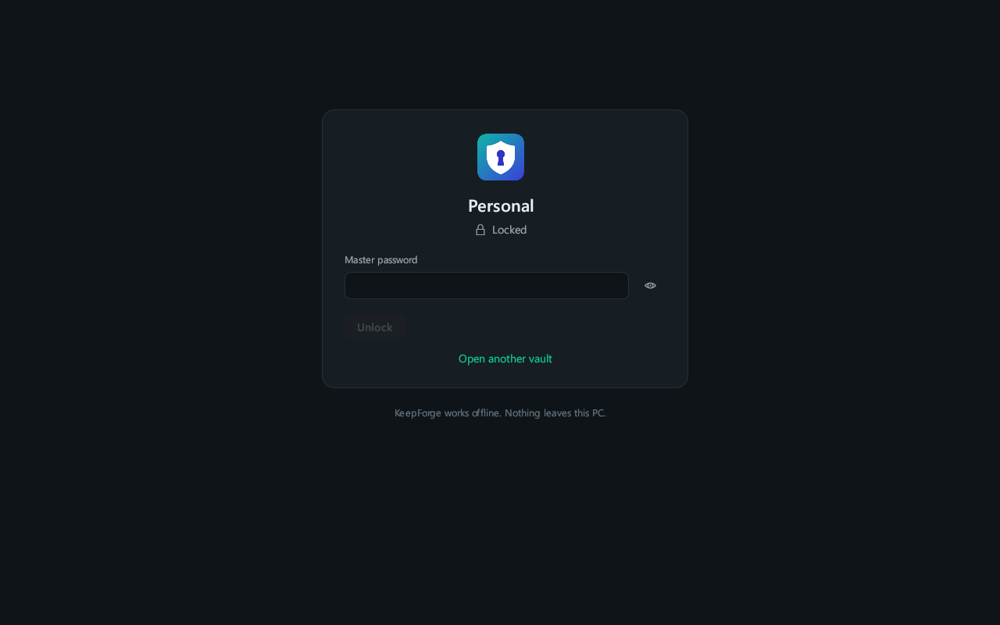</td>
<td width="50%" align="center"><b>Security dashboard</b><br>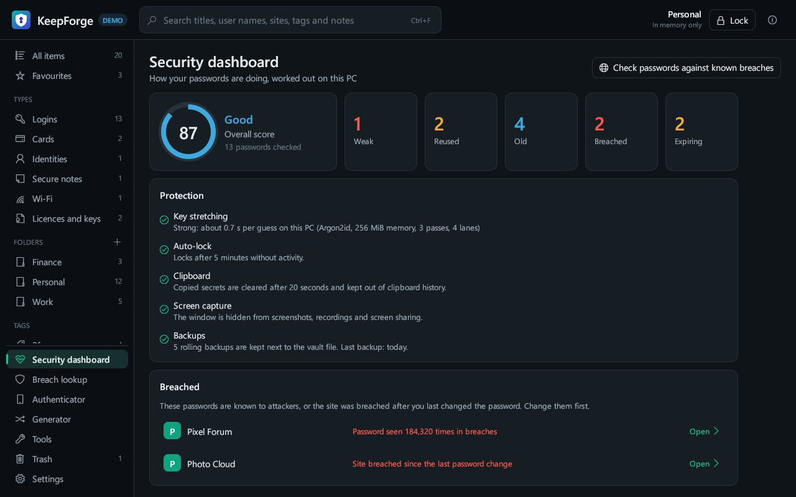</td>
</tr>
<tr>
<td width="50%" align="center"><b>Edit with inline generator</b><br>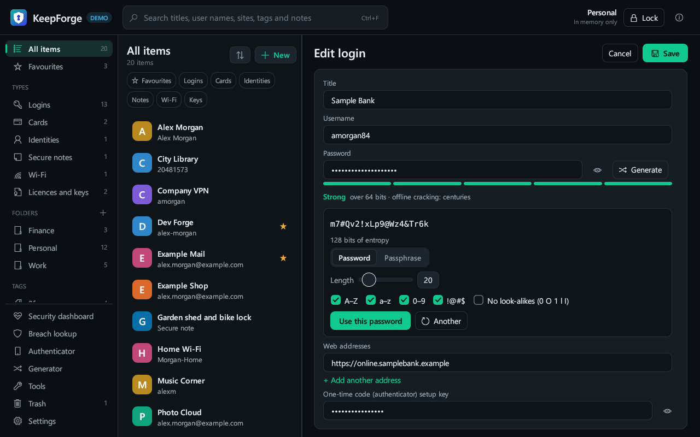</td>
<td width="50%" align="center"><b>Generator</b><br>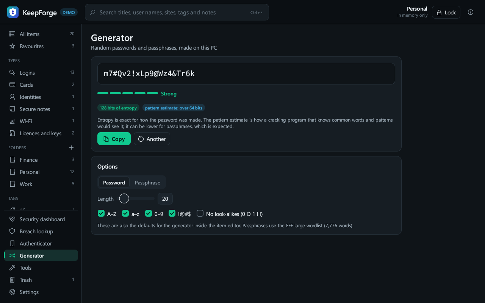</td>
</tr>
<tr>
<td width="50%" align="center"><b>Email breach lookup</b><br>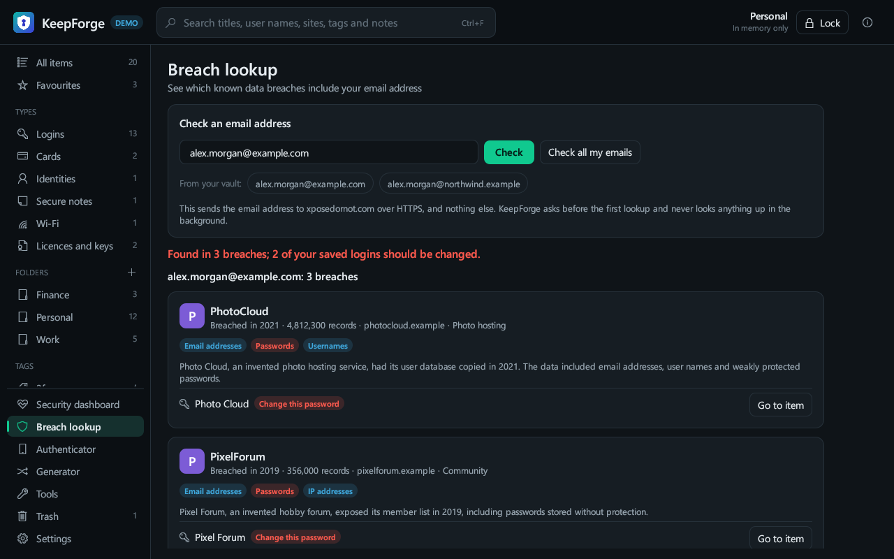</td>
<td width="50%" align="center"><b>Authenticator</b><br>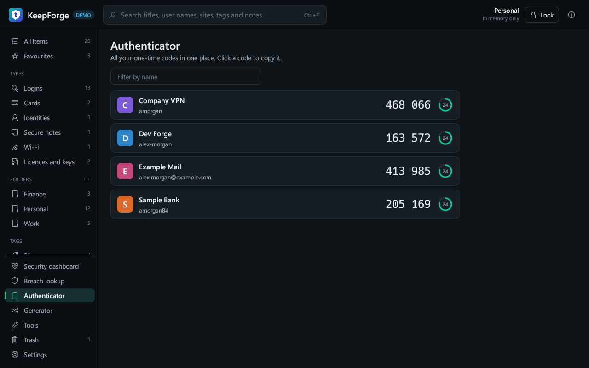</td>
</tr>
<tr>
<td width="50%" align="center"><b>Tools</b><br>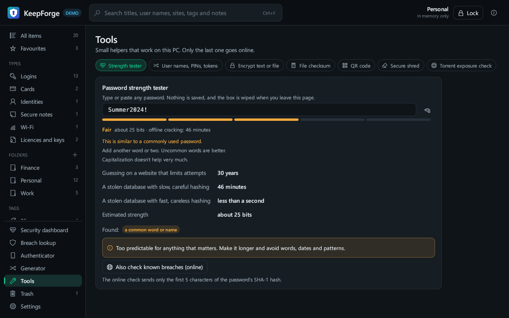</td>
<td width="50%" align="center"><b>Torrent exposure check</b><br>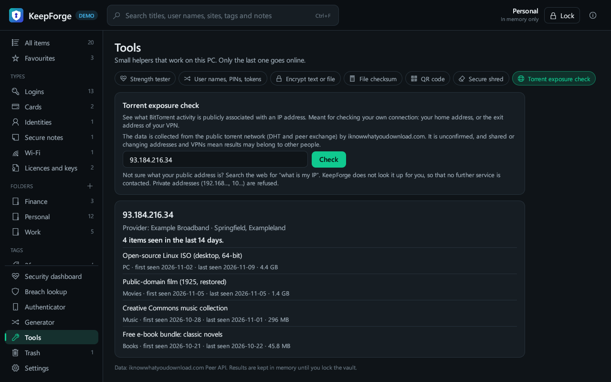</td>
</tr>
<tr>
<td width="50%" align="center"><b>Create a vault</b><br>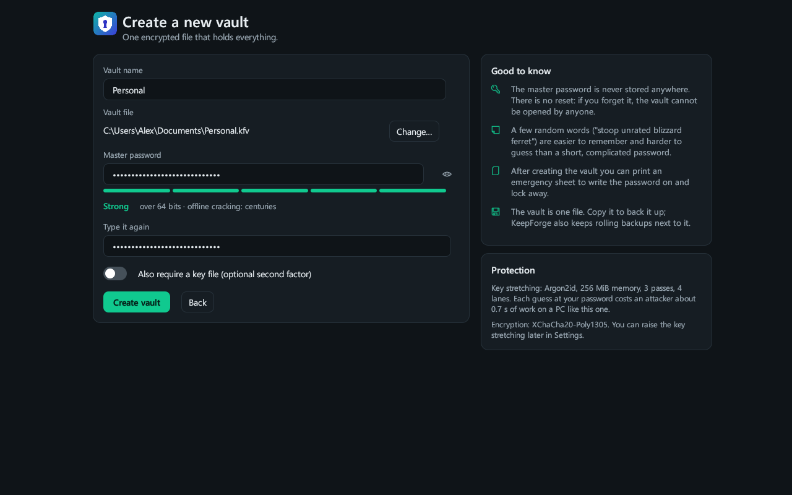</td>
<td width="50%" align="center"><b>Settings</b><br>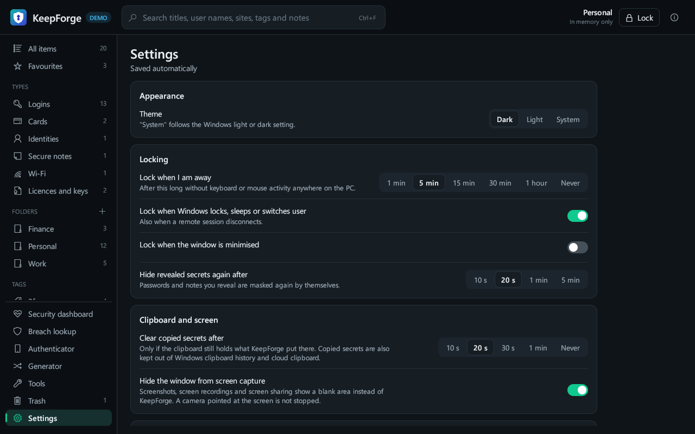</td>
</tr>
<tr>
<td width="50%" align="center"><b>Card item</b><br>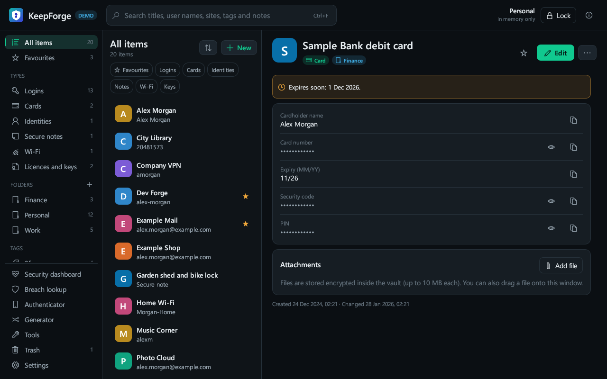</td>
<td width="50%" align="center"><b>Light theme</b><br>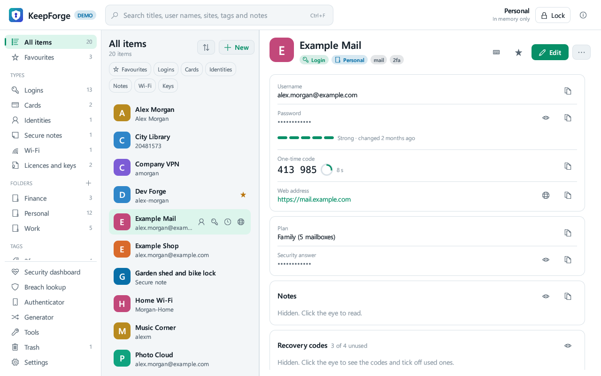</td>
</tr>
<tr>
<td width="50%" align="center"><b>Kurdish and Arabic text</b><br>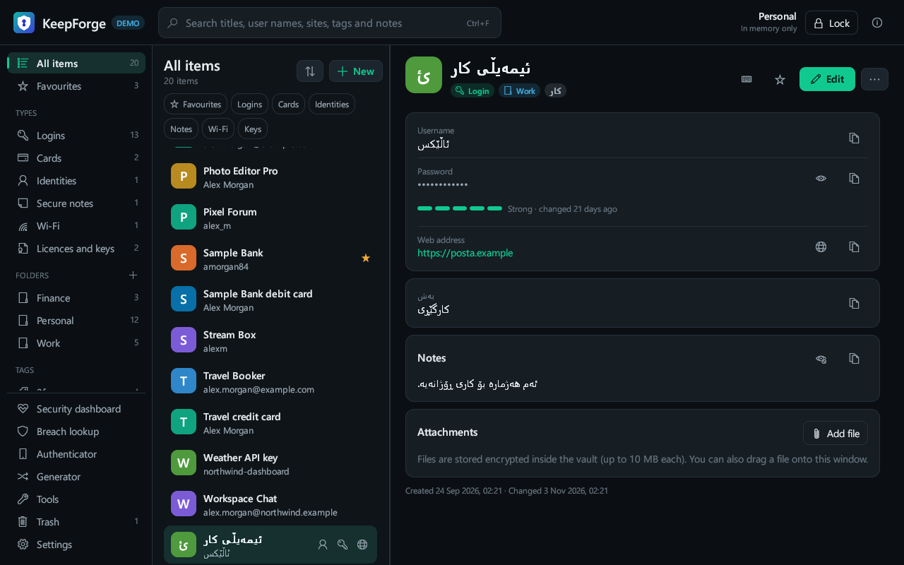</td>
<td width="50%" align="center"><b>Sorted by recently changed</b><br>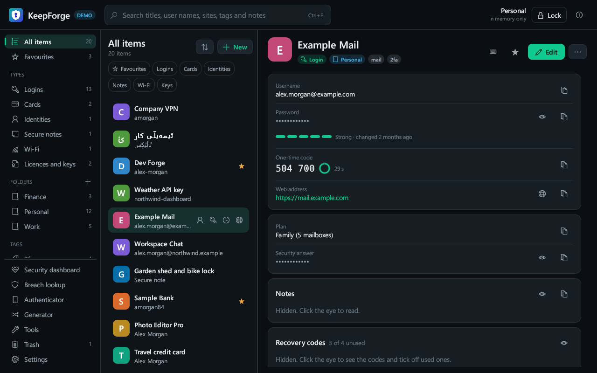</td>
</tr>
</table>

<sub>Screenshots use the built-in demo vault (<code>KeepForge.exe --demo</code>). Every name, address and breach in them is invented.</sub>

## 📥 Download

Get it from the [**latest release**](https://github.com/zheerkhalid/keepforge/releases/latest):

| File | What it is |
|---|---|
| `KeepForge-Setup.exe` | Per-user installer (no administrator rights), Start Menu shortcut, `.kfv` file association, uninstaller |
| `KeepForge-x.y.z-portable-x64.zip` | Portable: unzip and run. Settings stay next to the EXE, so it works from a USB stick |
| `KeepForge.exe` | The bare 8.3 MB EXE |

| Key | Action |
|---|---|
| `Ctrl+F` | Search |
| `Ctrl+N` | New item |
| `Ctrl+E` | Edit the selected item |
| `Ctrl+S` | Save |
| `Ctrl+B` / `Ctrl+C` / `Ctrl+T` | Copy the user name / password / one-time code |
| `Up` `Down` `Page Up` `Page Down` `Home` `End` | Move through the list (Up and Down also work from the search box) |
| `Enter` in the search box | Select the first result |
| `Delete` | Move the selected item to the trash |
| `Ctrl+L` | Lock the vault |

What changed in each version is in the [**changelog**](CHANGELOG.md).

**There is no password recovery.** If you lose the master password (or the key file, if you use one), nobody can open the vault, including the developer. Print the emergency sheet and keep it somewhere safe.

## 🛡️ Security

| | |
|---|---|
| **Encryption** | XChaCha20-Poly1305, a fresh random 192-bit nonce on every save; the header is authenticated and bound to the content |
| **Key derivation** | Argon2id, 256 MiB, 3 passes, 4 lanes by default; adjustable, never silently below the OWASP minimum |
| **Key separation** | HKDF-SHA-256 derives separate keys for the vault, the header and attachments |
| **What is encrypted** | Everything: titles, user names, sites, notes, attachments. The plain header holds only format numbers, KDF settings, a salt and a nonce |
| **Tamper detection** | Any change to the file is detected at unlock, and the vault is not opened |
| **Memory** | Secrets are wiped when the vault locks; secret buffers are locked out of the page file |
| **Clipboard** | Copied secrets stay out of Windows clipboard history and cloud sync, and are cleared after 20 seconds |
| **Screen** | The window asks Windows to leave it out of screenshots and screen recordings |
| **Process** | Other non-elevated programs are denied memory access; libraries load from System32 only; no crash dumps |
| **Saves** | Atomic writes and five rolling backups |

**What it cannot protect against:** malware or a keylogger running as you while the vault is unlocked, a weak master password, a compromised Windows or administrator, and anything you export or paste elsewhere in plain text. The full list, including known limits of this implementation, is in [`docs/SECURITY.md`](docs/SECURITY.md).

**Not in this version:** browser extension, passkeys, a sync service, mobile apps, Windows Hello unlock (a sound version needs a key that Hello itself protects, not a prompt in front of a stored key; see [`docs/SECURITY.md`](docs/SECURITY.md)).

**Known limits:** text boxes show Kurdish and Arabic letters unjoined while you type (the saved text is displayed properly everywhere else); the import layouts are tested with invented sample files, not with every version of every other program's export.

## 🌐 Optional online checks

KeepForge works fully offline. Three features contact a service, and only when you click:

| Feature | Service | What is sent |
|---|---|---|
| Leaked password check | [Pwned Passwords](https://haveibeenpwned.com/Passwords) | The first 5 characters of the password's SHA-1 hash. Never the password |
| Email breach lookup | [XposedOrNot](https://xposedornot.com) | The email address you check |
| Torrent exposure check | [iknowwhatyoudownload.com](https://iknowwhatyoudownload.com/en/api/) | The IP address you enter and your own API key |

Nothing from your vault is ever sent, and nothing is looked up in the background.

The torrent exposure check is meant for your own connection (home or VPN address) and needs a free demo key that you request from the service yourself; the key is stored inside your encrypted vault. Results for shared or changing addresses may belong to other people.

KeepForge is not affiliated with or endorsed by any of these services.

## 🏗️ Build from source

Requires Rust (stable, MSVC toolchain) on Windows.

```powershell
git clone https://github.com/zheerkhalid/keepforge
cd keepforge
cargo build --release
# -> target\release\KeepForge.exe
cargo test
# scripts\package.ps1 builds the EXE, the portable ZIP and the installer (it follows CARGO_TARGET_DIR)
```

Useful switches:

| Command | What it does |
|---|---|
| `KeepForge.exe --demo` | Open an invented in-memory vault; nothing is written |
| `KeepForge.exe --selftest` | Create a temporary vault and check save, reopen, wrong password, tampering, backups, import/export and lock wipe |
| `KeepForge.exe --hardening-report` | Print which process protections are active |
| `KeepForge.exe --screenshot out.png [--view name]` | Render the window to a PNG and exit (`--help` lists the views) |

```
src/
  vaultfile.rs   the .kfv format: header, KDF, encryption, padding
  store.rs       open, save, backups, merge
  secret.rs      wiped and locked secret buffers
  harden.rs      process protections
  clipboard.rs   protected copy and auto-clear
  generator.rs / strength.rs / totp.rs / health.rs
  hibp.rs / breach.rs / torrent.rs / net.rs   the optional online checks
  kfx.rs         password-encrypted files
  ui/            the egui interface (ui/bidi.rs draws right-to-left text)
tests/
  compat.rs      a vault written by 1.0.1 must still open, save and reopen
docs/
  FORMAT.md      the file formats, byte for byte
  SECURITY.md    threat model and known limits
```

The icon is drawn in code at build time (`build.rs`, using tiny-skia). The C runtime is linked statically, so the EXE runs on a clean Windows install.

## 🙏 Credits

- Passphrases use the [EFF Large Wordlist](https://www.eff.org/deeplinks/2016/07/new-wordlists-random-passphrases) (CC BY 3.0 US).
- Cryptography comes from the [RustCrypto](https://github.com/RustCrypto) crates; strength estimates from zxcvbn; the interface from [egui](https://github.com/emilk/egui).

See [`NOTICE`](NOTICE) for details.

## 👨‍💻 Developer

<table>
<tr>
<td align="center" width="140">
  <a href="https://zheer.dev">
    
  </a>
</td>
<td>

**Designed and developed by [Zheer Khalid](https://zheer.dev)**

🌐 Website: **[zheer.dev](https://zheer.dev)**  
🐙 GitHub: **[@zheerkhalid](https://github.com/zheerkhalid)**  
🧩 Also by Zheer: **[SnapForge](https://github.com/zheerkhalid/snapforge)** (screen capture and recording), **[ReelForge](https://github.com/zheerkhalid/reelforge)** (video converter) and **[UnForge](https://github.com/zheerkhalid/unforge)** (uninstaller)

If KeepForge is useful to you, a ⭐ on the repo is appreciated.

</td>
</tr>
</table>

## 📄 License

MIT © 2026 [Zheer Khalid](https://zheer.dev). See [`LICENSE`](LICENSE).

<div align="center">
<sub>Built with 🦀 Rust and ❤️ by <a href="https://zheer.dev">zheer.dev</a></sub>
</div>
